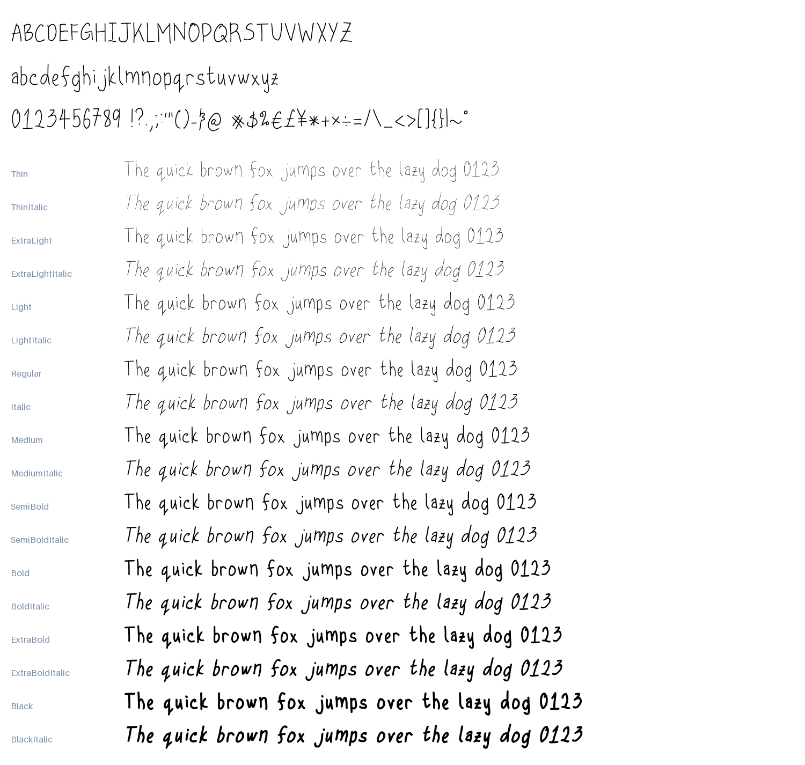

# miifont
as the name goes, its mii (pronounced "my") font. just for funsies.

*work might be halted for a while since classes are starting again ugh, but the foundation for the font is done.



## styles

9 weights, each with an italic: 18 styles.

| weight | upright | italic |
| --- | --- | --- |
| 100 | Thin | Thin Italic |
| 200 | ExtraLight | ExtraLight Italic |
| 300 | Light | Light Italic |
| 400 | Regular | Italic |
| 500 | Medium | Medium Italic |
| 600 | SemiBold | SemiBold Italic |
| 700 | Bold | Bold Italic |
| 800 | ExtraBold | ExtraBold Italic |
| 900 | Black | Black Italic |

Regular, Italic, Bold and Bold Italic share the family name `miifont`, so Ctrl+B / Ctrl+I in apps like Word picks the right file. The other weights show up as `miifont Light`, `miifont Black` and so on, and are grouped under `miifont` in design apps.

Covers A–Z, a–z, 0–9 and `! ? . , ; : ' " ( ) - & @ # $ % € £ ¥ * + × ÷ = / \ _ < > [ ] { } | ~ °`.

## variable font

[`fonts/variable`](fonts/variable) has `miifont[wght].ttf` and `miifont-Italic[wght].ttf` (plus `.woff2`), with a weight axis from 100 to 900. The named weights match the static fonts.

```css
@font-face {
  font-family: "miifont";
  src: url("miifont[wght].woff2") format("woff2");
  font-weight: 100 900;
  font-style: normal;
}
@font-face {
  font-family: "miifont";
  src: url("miifont-Italic[wght].woff2") format("woff2");
  font-weight: 100 900;
  font-style: italic;
}
```

## install

- **desktop:** grab the files from [`fonts/otf`](fonts/otf) (or [`fonts/ttf`](fonts/ttf) for older apps) and install them.
- **web:** use [`fonts/woff2`](fonts/woff2):

```css
@font-face {
  font-family: "miifont";
  src: url("miifont-Regular.woff2") format("woff2");
  font-weight: 400;
  font-style: normal;
}
@font-face {
  font-family: "miifont";
  src: url("miifont-BoldItalic.woff2") format("woff2");
  font-weight: 700;
  font-style: italic;
}
/* ...one block per style you need */
```

## how it's made

The glyphs come from two handwritten template sheets in [`scans/`](scans).

1. `scripts/extract.py` lines each scan up using the black corner squares, cuts out the 7×7 grid of boxes and finds the baseline in each box.
2. `scripts/build_font.py` keeps only the black ink, traces each glyph down to its stroke centreline and re-strokes it with a round pen. Regular uses the pen width measured from the scans, and the other weights are multiples of it (0.45× for Thin up to 2.8× for Black). Italics are the upright outlines slanted 12°. Every style is written as OTF, TTF and WOFF2.
3. `scripts/build_variable.py` builds the variable fonts. Filled outlines traced separately for each weight can't be interpolated, so here each stroke centreline is drawn as a chain of round-ended segments. Thin and Black then have exactly the same points, and every weight in between is exact. The segments overlap on purpose and are flagged so renderers fill them correctly.
4. `scripts/specimen.py` renders `specimen.png`.

Shared glyph analysis lives in `scripts/common.py`.

## rebuild

```sh
python -m venv .venv
.venv/bin/pip install -r requirements.txt   # Windows: .venv\Scripts\pip
.venv/bin/python scripts/extract.py
.venv/bin/python scripts/build_font.py
.venv/bin/python scripts/build_variable.py
.venv/bin/python scripts/specimen.py
```

To change a letter, redraw it on the template, replace the scan in `scans/` and rebuild.

## jawi (coming soon)

Printable templates for adding Jawi, in two guide styles:

- **Naskh:** [`templates/jawi/naskh/miifont-jawi-naskh.pdf`](templates/jawi/naskh/miifont-jawi-naskh.pdf)
- **Thuluth:** [`templates/jawi/thuluth/miifont-jawi-thuluth.pdf`](templates/jawi/thuluth/miifont-jawi-thuluth.pdf)

Each has an instructions page plus 5 pages with 151 cells:

- all 28 Arabic letters, the Jawi letters چ ڠ ڤ ݢ ڽ ۏ, ة, the hamzah forms (أ إ ؤ ئ ء) and لا
- every letter in each contextual shape it takes: tunggal, awal, tengah, akhir
- tatwil and Arabic punctuation (، ؛ ؟), plus optional Arabic digits

Every cell has a faint guide letter to trace or follow. It's printed light enough to be dropped automatically when the scan is processed, so only your own ink ends up in the font. Sides that join a neighbouring letter have a tick on the baseline, and the joining stroke runs right up to it so the letters connect cleanly once typed. Shapes with long tails get double-width cells.

Layla Thuluth has no ڠ ݢ ڽ ۏ, so in the Thuluth template those cells show the base letter (ع ك ن و) with a note on which dots to add.

Both styles share one layout. `scripts/jawi_template.py` generates the PDFs and `templates/jawi/layout.json`, which records where every cell is so the scans can be cut up. The guide fonts are in [`templates/jawi/fonts`](templates/jawi/fonts) (both OFL).

## known limitations

- no kerning yet, so some pairs (like `AV` or `Ty`) may sit a little loose or tight.
- italics are a mechanical slant, not redrawn.
